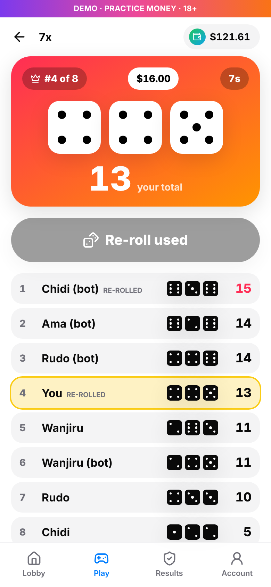
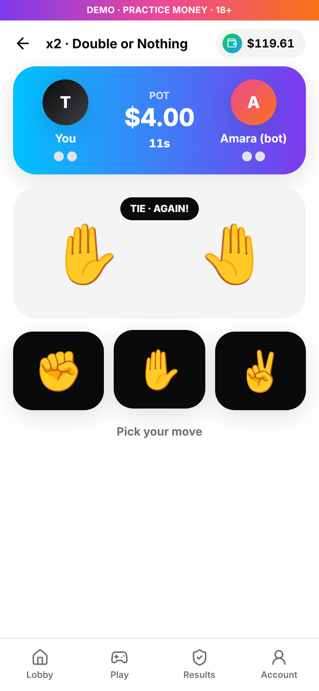
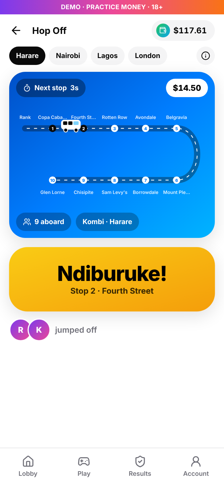
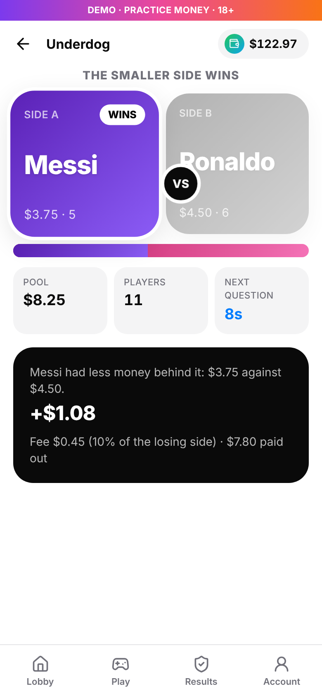

<div align="center">
  <h1>QikWins</h1>
  <p><strong>Wins done right!</strong> Beat people, not the house.</p>
</div>

QikWins is a website of live pool games where players compete against each other, not against the operator. Everyone in a round puts into one pool, the winners share it, and QikWins takes a fixed fee that is shown before anyone plays. Every finished round is published.

This first version runs in **demo mode**: every player gets $100 of practice money and no real cash moves. It's built on the same stack and design as [QikDrive](https://github.com/alist549/QikDriveZw): React, Vite and Tailwind on the web, Node, Express, MongoDB and Socket.IO on the server, Inter, black and white with QikDrive blue.

| Lobby | 7x, rolling | x2, throw | Hop Off, riding | Underdog |
| --- | --- | --- | --- | --- |
|  |  |  |  |  |

## The games

The lobby shows every game as an animated tile with its live player count. Four are playable in the demo; the rest are shown as coming soon.

### 7x

Eight players at the same stake roll three dice each, with one re-roll. The highest total takes the table: all eight stakes, less a 10% fee on the other seven, so a lone winner gets back about 7.3x. Tied winners split it. Players can leave for a full refund until the dice roll.

### x2 (Double or Nothing)

Two players at the same stake play rock-paper-scissors, 10 seconds a throw, ties replayed. First to 2 wins takes both stakes, less a 10% fee from the loser's stake. Cancel for a full refund while waiting for an opponent.

In the demo, if nobody else is waiting at your stake, labelled demo players ("Zola (bot)") fill the empty seats in 7x and x2 after a few seconds. Set `DEMO_OPPONENTS=off` to turn them off.

### Hop Off

A shared ride drives a 10-stop route, one stop every 2.5 seconds. Players board with $0.25 to $5, then tap **Get off** whenever they like (or preset a stop for weak signal). A hidden checkpoint catches everyone still aboard.

- Riders who got off keep their stake and share the caught riders' money, after a 10% fee, weighted by stake times stops ridden. A rider who gets off never gets back less than they staked.
- If nobody is caught, everyone gets their stake back and QikWins earns nothing.
- If everyone is caught, the money (less the fee) rides on into the next ride.
- The checkpoint is fixed before boarding: its SHA-256 fingerprint is shown while people board and the seed is revealed after, so anyone can check it (see `Backend/services/fair.js`).
- The look changes per city (Harare kombi, Nairobi matatu, Lagos danfo, London night bus); the rules and maths don't.

### Underdog

A two-sided question ("Tea or coffee?"). Players back a side for 45 seconds. Side totals stay hidden until the clock stops; then the side with **less** money behind it wins and shares the other side's stakes after a 10% fee. A tie or a one-sided round refunds everyone with no fee. The players decide the result, so there's no random draw to trust.

## Responsible play

18+ confirmation at sign-in, stakes capped per round, a one-tap pause on all play for 1, 7 or 30 days, and the fee explained on every result. Real-money play would also need SMS codes, identity checks, deposit limits and a licence in each market.

## Run it

You need Node 20+. MongoDB is optional for a quick try.

```bash
# Server, without a database (data is lost on restart)
cd Backend && npm install && STORE=memory npm run dev

# Website
cd Frontend && cp .env.example .env && npm install && npm run dev
```

Open http://localhost:5173. With MongoDB, leave out `STORE=memory` and set `MONGODB_URL` (see `Backend/.env.example`). Game timings, fees and stake limits are environment settings in `Backend/config/games.js`.

Docker: `docker compose up --build`, then open http://localhost:5173.

## Tests

- `Backend`: `npm test` covers the pool maths (including the worked examples from the game design doc), provably fair draws, both game engines and the API. With `MONGODB_URL` set it also tests the MongoDB store.
- `e2e`: with the server and website running, `npm install && node play.js` plays both games in a phone-sized Chromium with ten bot players and saves the screenshots in `docs/screenshots`.

## Layout

```
Backend/
  config/games.js     game rules: stakes, fees, timings, Underdog questions
  services/payouts.js pool maths in whole cents (nothing created or lost)
  services/fair.js    commit-reveal seeds for Hop Off checkpoints
  services/store.js   players and the results log (MongoDB or in memory)
  games/              Hop Off, Underdog, x2 and 7x engines
  services/bots.js    labelled demo players for empty x2 and 7x seats
  app.js, socket.js   HTTP API and live updates
Frontend/             React website
e2e/                  Playwright playthrough and screenshots
```

## Credits

`Frontend/src/components/Button.jsx`, `Spinner.jsx` and `contexts/ThemeContext.jsx`, the theme tokens and the Docker setup are adapted from QikDrive. No licence has been chosen for QikWins yet.
