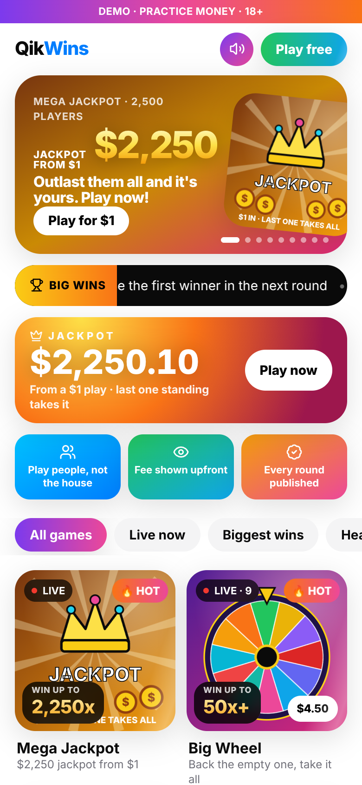
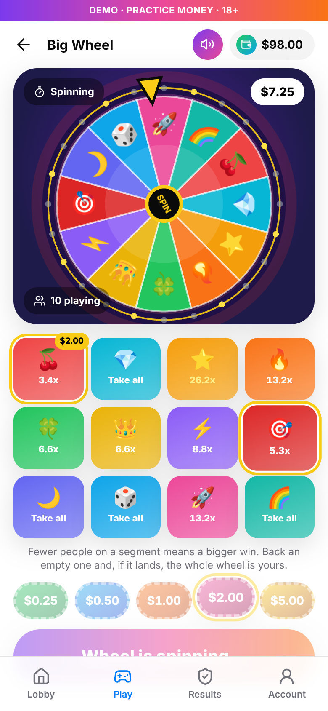
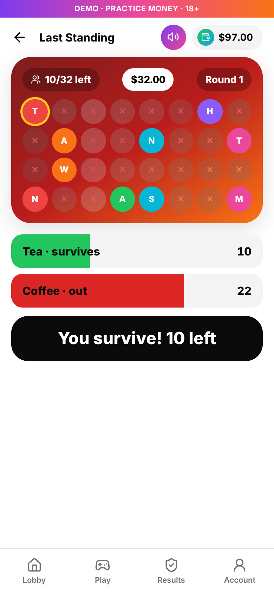
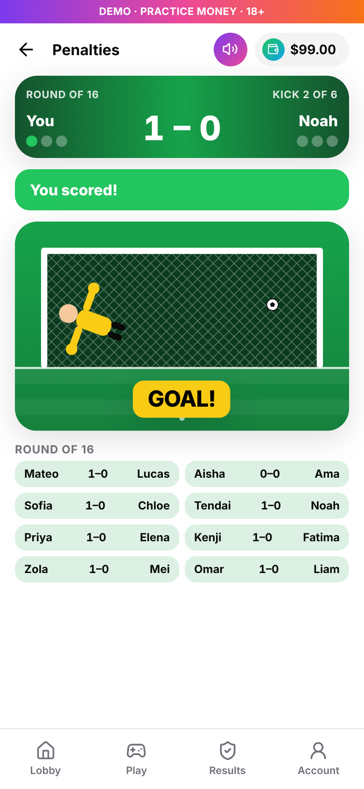
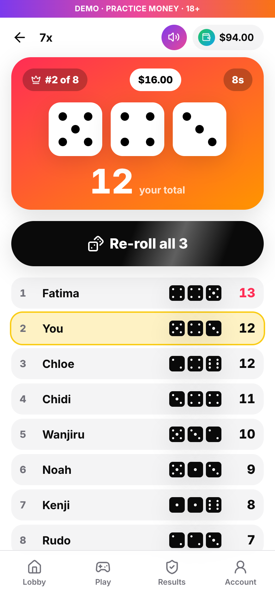
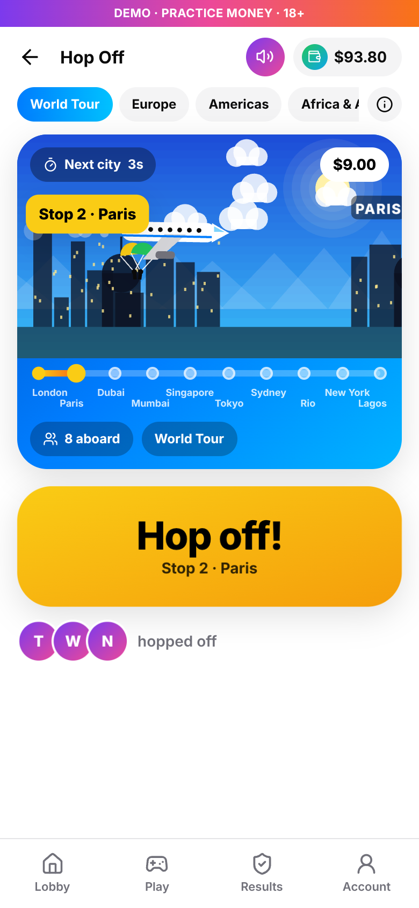

<div align="center">
  <h1>QikWins</h1>
  <p><strong>Wins done right!</strong> Beat people, not the house.</p>
</div>

QikWins is a website of live pool games where players compete against each other, not against the operator. Everyone in a round puts into one pool, the winners share it, and QikWins takes a fixed fee that is shown before anyone plays. Every finished round is published.

This first version runs in **demo mode**: every player gets $100 of practice money and no real cash moves. It's built on the same stack and design as [QikDrive](https://github.com/alist549/QikDriveZw): React, Vite and Tailwind on the web, Node, Express, MongoDB and Socket.IO on the server, Inter, black and white with QikDrive blue.

| Lobby | Big Wheel | Last Standing | Penalties | 7x | Hop Off |
| --- | --- | --- | --- | --- | --- |
|  |  |  |  |  |  |

Short clips of each game in motion are in `docs/clips`.

## The games

The lobby shows every game as an animated tile with its live player count and the most it can pay. Seven are playable in the demo; the rest are shown as coming soon.

### Big Wheel

A prize wheel with 12 segments. While it's open (20 seconds), players stake on any segments and each segment shows what it would pay right now. Then it spins. Stakes on the winning segment share the whole wheel by stake, less a 10% fee from the losing stakes, so a segment few people backed can pay 50x or more. If nobody backed the winner, the wheel (less the fee) rolls over into the next spin as a jackpot. The winning segment is drawn from a seed whose SHA-256 fingerprint is shown before anyone stakes, and the seed is published after.

### Last Standing

A knockout for 32 players at one stake. Each round asks a two-way question with 8 seconds to answer, and only the side fewer players picked survives (a tie keeps both; not answering knocks you out). After one player is left, or 8 rounds, the survivors share every stake, less a 10% fee from the knocked-out players' stakes: about 29x for a lone winner.

### Penalties

Shootouts against real people, picking one of 3 directions: left, centre or right. Players take turns to shoot and keep: the shooter picks a side, the keeper picks which way to dive, and it's saved only if they match. 3 kicks each, then sudden death. Choose how to play:

- **1 v 1**: one shootout, winner takes both stakes less a 10% fee from the loser's stake (about 1.9x).
- **World Cup**: a 16-player knockout of shootouts. Winning a match adds your opponent's bank (less the fee) to yours. After each round the players still in choose to cash out their bank or play on for double; no answer means cash out. The champion of a full cup gets back about 13x.

### 7x

Eight players at the same stake roll three dice each, with one re-roll. The highest total takes the table: all eight stakes, less a 10% fee on the other seven, so a lone winner gets back about 7.3x. Tied winners split it. Players can leave for a full refund until the dice roll.

### x2 (Double or Nothing)

Two players at the same stake play rock-paper-scissors, 10 seconds a throw, ties replayed. First to 2 wins takes both stakes, less a 10% fee from the loser's stake. Cancel for a full refund while waiting for an opponent.

In the demo, practice players (demo accounts with ordinary names and practice money) fill empty seats so nobody waits; the sign-in screen says so. Set `DEMO_OPPONENTS=off` to turn them off. With `REAL_MONEY=on` they are always off: in real-money play the house must never take a seat.

### Hop Off

A shared flight visits 10 real cities, one every 2.5 seconds, on one of four routes (World Tour, Europe, Americas, Africa & Asia). Players board with $0.25 to $5, then tap **Hop off!** whenever they like (or preset a city for weak signal). A hidden checkpoint city catches everyone still aboard.

- Riders who got off keep their stake and share the caught riders' money, after a 10% fee, weighted by stake times stops ridden. A rider who gets off never gets back less than they staked.
- If nobody is caught, everyone gets their stake back and QikWins earns nothing.
- If everyone is caught, the money (less the fee) rides on into the next ride.
- The checkpoint is fixed before boarding: its SHA-256 fingerprint is shown while people board and the seed is revealed after, so anyone can check it (see `Backend/services/fair.js`).
- The routes change the cities and the sky; the rules and maths don't.

### Underdog

A two-sided question ("Tea or coffee?"). Players back a side for 45 seconds. Side totals stay hidden until the clock stops; then the side with **less** money behind it wins and shares the other side's stakes after a 10% fee. A tie or a one-sided round refunds everyone with no fee. The players decide the result, so there's no random draw to trust.

## Motion and sound

- [Motion](https://motion.dev) (the React animation library) drives the interface: springy chips, counters that count up, hands that slam in, leaderboards that re-sort live.
- [PixiJS](https://pixijs.com) draws the real-time game scenes in WebGL: Hop Off's flight over the world and the Big Wheel. It loads only on those screens.
- [Tone.js](https://tonejs.github.io) makes every sound effect and both music loops (lobby and in-game) in the browser from code, so there are no audio files to license. The speaker button in the header mutes it all, and nothing plays until the player's first tap.

## Responsible play

18+ confirmation at sign-in, stakes capped per round, a one-tap pause on all play for 1, 7 or 30 days, and the fee explained on every result. Real-money play would also need SMS codes, identity checks, deposit limits and a licence in each market.

## Run it

You need Node 20+. MongoDB is optional for a quick try.

```bash
# Server, without a database (data is lost on restart)
cd Backend && npm install && STORE=memory npm run dev

# Website
cd Frontend && cp .env.example .env && npm install && npm run dev
```

Open http://localhost:5173. With MongoDB, leave out `STORE=memory` and set `MONGODB_URL` (see `Backend/.env.example`). Game timings, fees and stake limits are environment settings in `Backend/config/games.js`.

Docker: `docker compose up --build`, then open http://localhost:5173.

## Put it online (Render, free)

`render.yaml` is a Render Blueprint. In Render, choose **New > Blueprint**, pick this repository, and click **Apply**. One free web service builds the website, runs the game server and serves both from one address. Free instances sleep after 15 minutes without visitors and take about a minute to wake, and with `STORE=memory` a restart resets the demo. For data that lasts, add a free MongoDB Atlas cluster, set `MONGODB_URL` and remove `STORE`.

To run it the same way locally: build the website with `VITE_SERVER_URL=/ npm run build`, then start the server with `WEB_DIR=../Frontend/dist`.

## Tests

- `Backend`: `npm test` covers the pool maths (including the worked examples from the game design doc), provably fair draws, both game engines and the API. With `MONGODB_URL` set it also tests the MongoDB store.
- `e2e`: with the server and website running, `npm install && node play.js` plays both games in a phone-sized Chromium with ten bot players and saves the screenshots in `docs/screenshots`.

## Layout

```
Backend/
  config/games.js     game rules: stakes, fees, timings, Underdog questions
  services/payouts.js pool maths in whole cents (nothing created or lost)
  services/fair.js    commit-reveal seeds for Hop Off checkpoints and Big Wheel spins
  services/store.js   players and the results log (MongoDB or in memory)
  games/              Hop Off, Underdog, x2, 7x, Big Wheel, Last Standing and Penalties engines
  services/bots.js    practice players for empty seats (demo only)
  app.js, socket.js   HTTP API and live updates
Frontend/             React website
  src/scenes/         PixiJS scenes (Hop Off flight, Big Wheel)
  src/components/Goal.jsx  the animated goal, keeper and ball for Penalties
  src/lib/sound.js    sound effects and music (Tone.js)
e2e/                  Playwright playthrough and screenshots
```

## Credits

`Frontend/src/components/Button.jsx`, `Spinner.jsx` and `contexts/ThemeContext.jsx`, the theme tokens and the Docker setup are adapted from QikDrive. No licence has been chosen for QikWins yet.
